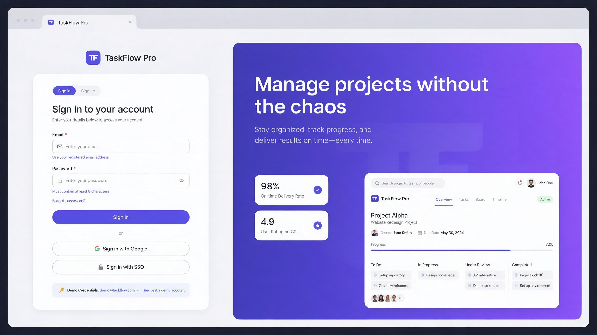
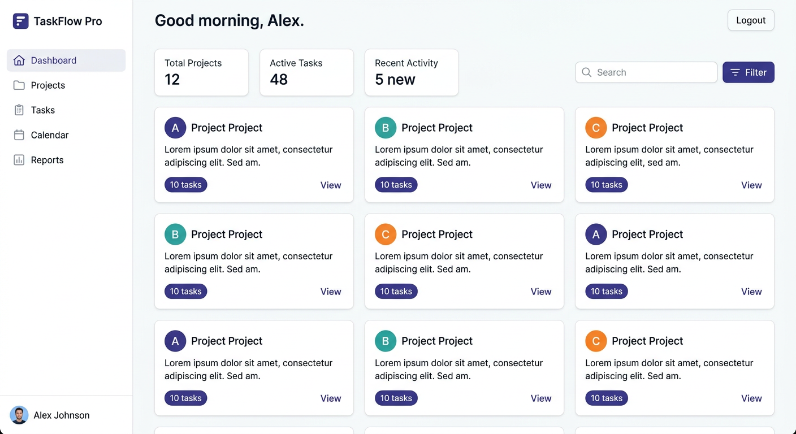
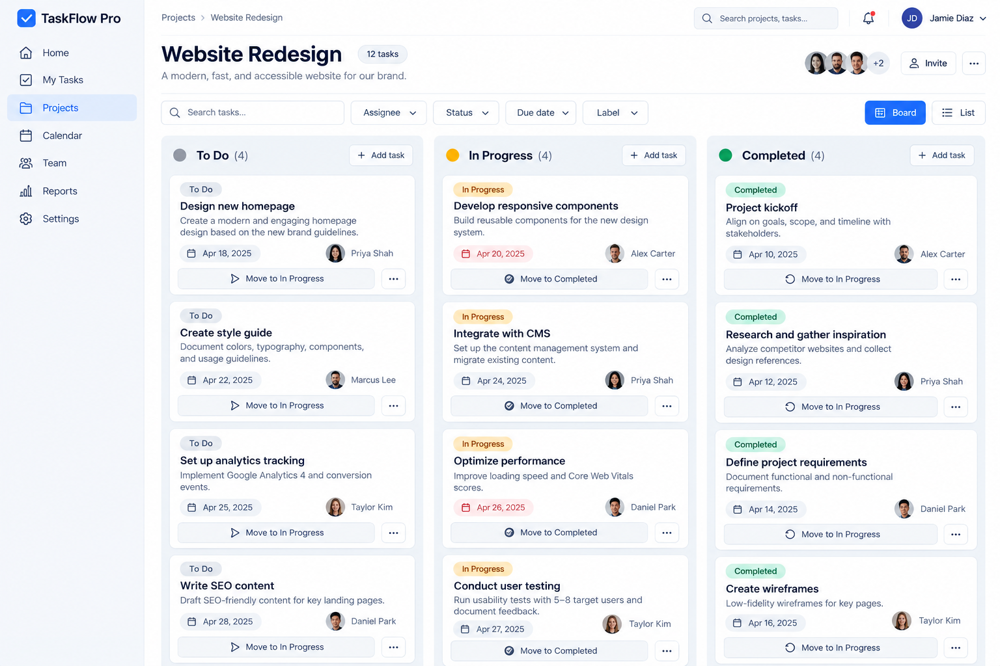
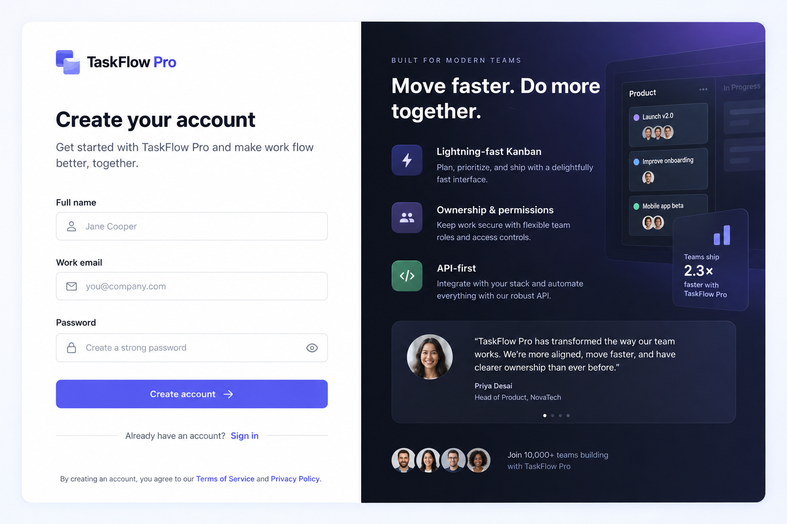
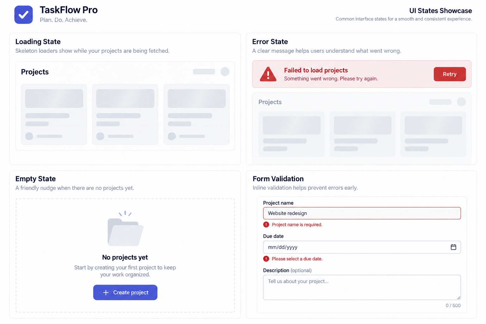

# TaskFlow Pro

**TaskFlow Pro** is a lightweight full-stack task management application for remote teams to organize projects, assign tasks, and track progress.

A typed **Express REST API** backed by PostgreSQL through Prisma, with JWT authentication, request validation, and integration tests — plus a modern **React + Vite + Tailwind CSS** frontend fully integrated with the API including loading, error, and empty states.

> **Live:** API `http://localhost:3000` · Web `http://localhost:5173` · Health `GET /health`

---

## ✨ UI Preview

A fully responsive, production-ready single-page application with protected routes, Kanban board, and optimistic UX states.

| Authentication | Dashboard |
|---|---|
|  |  |
| *Split-screen login with demo credentials and hero gradient — validates email/password with inline errors and loading spinner on submit* | *Sidebar + stat cards + project grid with search, sort, pagination — skeleton loaders while fetching, error banner with retry, and empty-state CTA* |

| Project Board (Kanban) | Registration |
|---|---|
|  |  |
| *Project header + filter toolbar + 3-column Kanban (To Do → In Progress → Completed) with task cards, due-date pills, assignee badges, and status move buttons + List view toggle* | *Registration with name/email/password validation, field-level error messages, and marketing panel* |

| Loading & Error States |
|---|
|  |
| *Shimmer skeletons, retryable error banners, dashed empty states, and inline validation — every API call handles `isLoading`, `error`, and `empty` explicitly* |

> Screenshots live in [`screenshots/`](screenshots/). The frontend source is in [`frontend/`](frontend/).

---

## 1. System Architecture

**3-Tier Full-Stack Architecture:**

```
┌─────────────────────────┐      ┌─────────────────────────┐      ┌──────────────────┐
│  Frontend (SPA)         │      │  Backend (REST API)     │      │  Database        │
│  React 18 + Vite 6      │ ───▶ │  Node 20 + Express 5    │ ───▶ │  PostgreSQL 16   │
│  React Router 6          │  JWT │  Prisma 6 ORM           │      │  via Prisma      │
│  Tailwind CSS 3          │      │  Zod + Helmet + CORS    │      │  + PGlite (tests)│
│  Axios + Context API     │      │  bcrypt + rate-limit    │      │                  │
└─────────────────────────┘      └─────────────────────────┘      └──────────────────┘
         │                                    │                           │
         └───────────── Vite proxy / express.static (prod) ──────────────┘
```

- **Frontend:** React 18 + TypeScript, Vite, Tailwind CSS, React Router, Axios, Context API for auth
- **Backend:** Node.js 20 + Express 5 REST API with Zod validation, JWT, bcrypt, Helmet, CORS, rate-limiting
- **Database:** PostgreSQL 16 managed via Prisma ORM (indexes on `ownerId`, `projectId`, compound `(projectId,status)`)
- **Authentication:** JWT (HS256, issuer/audience checked, expiring) with bcrypt password hashing
- **Validation:** Zod schemas at the HTTP boundary — strict, field-level errors, unknown-field rejection
- **Testing:** Vitest + Supertest + PGlite (in-process Postgres, no Docker needed)

---

## 2. Data Models

### User

- `id` — UUID, primary key
- `name` — String (100)
- `email` — String (320), unique, normalized to lowercase
- `passwordHash` — String, bcrypt hash (never returned by the API)
- `createdAt`, `updatedAt` — Timestamps with timezone

### Project

- `id` — UUID, primary key
- `title` — String (120)
- `description` — Text, optional
- `ownerId` — UUID, foreign key to User (cascade delete)
- `createdAt`, `updatedAt` — Timestamps with timezone
- **Computed:** `taskCount` — included on every read

### Task

- `id` — UUID, primary key
- `projectId` — UUID, foreign key to Project (cascade delete)
- `assignedTo` — UUID, optional foreign key to User (set null on delete)
- `title` — String (200)
- `description` — Text, optional
- `status` — Enum: `TODO`, `IN_PROGRESS`, `COMPLETED` (defaults to `TODO`)
- `dueDate` — PostgreSQL `DATE`, optional (YYYY-MM-DD, validated against invalid calendar dates)
- `createdAt`, `updatedAt` — Timestamps with timezone

Prisma schema: [`prisma/schema.prisma`](prisma/schema.prisma) · Migration: [`prisma/migrations/20261023130000_init/migration.sql`](prisma/migrations/20261023130000_init/migration.sql)

---

## 3. Project Structure

```text
.
├── frontend/                   React SPA (Vite + Tailwind)
│   ├── src/
│   │   ├── api/                Axios client, auth/projects/tasks modules
│   │   ├── components/         Layout, LoadingSpinner, ErrorBanner, ui primitives
│   │   ├── contexts/           AuthContext (JWT + /me refresh)
│   │   ├── pages/              Login, Register, Dashboard, ProjectDetail, 404
│   │   ├── lib/                utils (cn, dates, initials)
│   │   └── types/              Shared TS interfaces
│   ├── index.html
│   ├── vite.config.ts          Proxy /api → :3000, host 0.0.0.0
│   └── tailwind.config.js
├── src/                        Express API
│   ├── app.ts                  Express app, middleware, route mounting, static frontend (prod)
│   ├── server.ts               HTTP server + graceful shutdown
│   ├── config/env.ts          Validated env (Zod)
│   ├── lib/                    Prisma client, errors, JWT, pagination, selects
│   ├── middlewares/            auth, validation, error-handler
│   └── modules/
│       ├── auth/               Register, login, current user
│       ├── projects/           Full project CRUD
│       └── tasks/              Full task CRUD, filtering, assignment
├── prisma/
│   ├── schema.prisma
│   ├── migrations/
│   └── seed.ts                 Demo user, project, and tasks
├── screenshots/                UI screenshots for README
│   ├── 01-login.png
│   ├── 02-dashboard.png
│   ├── 03-kanban.png
│   ├── 04-register.png
│   └── 05-details-list.png
├── tests/
│   └── api.test.ts             End-to-end tests via PGlite
├── docker-compose.yml
└── package.json                Root scripts orchestrate api + web
```

---

## 4. Frontend — Feature Overview

### Pages & Routing

| Route | Component | Access | Description |
|---|---|---|---|
| `/login` | `LoginPage` | Public | Email/password form, demo hint, SSO placeholders, inline validation, error banner, redirect to `/dashboard` on success |
| `/register` | `RegisterPage` | Public | Name/email/password, Zod-style validation, field errors, success → auto-login |
| `/dashboard` | `DashboardPage` | Protected | Stat cards, search + sort, project grid (3-col), pagination, create/edit/delete modals |
| `/projects/:projectId` | `ProjectDetailPage` | Protected | Project header, filter toolbar, **Kanban board** (3 columns) + **List view**, task CRUD, status transitions |
| `*` | `NotFoundPage` | Public | 404 with back-to-dashboard CTA |

### API Integration

Centralized Axios client (`src/api/client.ts`):

```ts
// Automatically attaches Bearer token, unwraps { data, pagination } and { error: { code, message, details } }
apiClient.interceptors.request.use(/* inject JWT */)
apiClient.interceptors.response.use(/* 401 → logout + redirect */)

getApiErrorMessage(error) // normalizes network/validation/auth errors → { message, details[] }
```

Modules: `api/auth.ts`, `api/projects.ts`, `api/tasks.ts` — typed wrappers for every endpoint with query-param support (`page`, `limit`, `search`, `status`, `sortBy`, `sortOrder`).

### Auth Flow

- `AuthContext` stores `token` + `user` in `localStorage` (`taskflow_token`, `taskflow_user`)
- On mount, calls `GET /api/auth/me` to validate/refresh profile; on 401 clears storage and redirects to `/login`
- `ProtectedRoute` and `PublicOnly` guards handle `loading` → spinner, `!isAuthenticated` → redirect

### Loading, Error & Empty States

Every data fetch exposes three states:

- **Loading:** `LoadingSpinner` (sm/md/lg/xl), `ProjectCardSkeleton`, `TaskSkeleton`, `PageSkeleton` with shimmer animation
- **Error:** `ErrorBanner` — icon + message + collapsible `details[]` + **Retry** button + optional dismiss; `InlineError` for field validation (`{ field, message }[]` from API)
- **Empty:** `EmptyState` — dashed card, icon, title, description, CTA button (e.g., “Create your first project”)

Examples:
- Dashboard: skeleton grid while `GET /api/projects` pending → error banner on failure with retry → empty state with search-aware message
- Project board: per-column “No tasks” placeholders, task-level optimistic status moves with error fallback
- Forms: button `loading` spinner, field-level `error` props, top-level `submit` error from `error.details`

---

## 5. Backend Implementation

Key behavior:

- **Complete Tasks resource:** create, read, list/filter/search/sort/paginate, update (PUT/PATCH), and delete, with ownership checks
- **Validation:** Zod schemas enforce types, string lengths, UUIDs, enums, ISO dates, unknown-field rejection, and at least one field on updates. Errors return field-level details
- **Authorization:** every project and task is scoped to its owner. Foreign resources return `404` rather than leaking existence
- **Consistency:** duplicate emails → `409 EMAIL_IN_USE`; invalid assignees → `400 INVALID_ASSIGNEE`; FK/P2002/P2003/P2025 mapped to API envelopes
- **Security:** Helmet (CSP disabled for SPA), CORS allowlist, 100kb body limit, `/api/auth` rate-limit (50/15m), bcrypt (12 rounds), signed/expiring JWTs (issuer/audience)

Production static serving: `src/app.ts` detects `frontend/dist` and serves it with SPA fallback (`GET /{*any}` → `index.html`), so `npm run build && npm start` serves both API and web on one origin.

---

## 6. Running Locally

### Prerequisites

- Node.js 20.19+ and Docker (for PostgreSQL)
- Optionally, no Docker needed for tests (PGlite in-process)

### Quick start (API + Web)

```bash
# 1. Install deps
npm install
npm --prefix frontend install

# 2. Env
cp .env.example .env
# edit DATABASE_URL and JWT_SECRET (32+ chars)

# 3. Database
docker compose up -d
npx prisma migrate deploy
npm run db:seed      # optional demo data

# 4a. Run side-by-side (recommended for development)
npm run dev          # API on :3000 (tsx watch)
npm --prefix frontend run dev   # Web on :5173 (Vite, proxies /api → :3000)

# 4b. Or run both with one command (requires concurrently)
npm run dev:all

# 5. Production single-origin
npm run build        # builds api (tsc) + web (vite)
npm start            # serves API + frontend/dist on :3000
```

The API starts at `http://localhost:3000` (health: `GET /health`), web at `http://localhost:5173`.

Demo credentials after seeding: `demo@taskflow.dev` / `Password123!`.

### Environment variables

| Variable | Required | Default | Purpose |
| :--- | :--- | :--- | :--- |
| `DATABASE_URL` | yes | - | PostgreSQL connection string |
| `JWT_SECRET` | yes | - | At least 32 characters |
| `JWT_EXPIRES_IN` | no | `1d` | Token lifetime |
| `BCRYPT_ROUNDS` | no | `12` | Password hashing cost |
| `PORT` | no | `3000` | HTTP port |
| `NODE_ENV` | no | `development` | Runtime mode |
| `CORS_ORIGIN` | no | `*` | Comma-separated allowed origins (use `http://localhost:5173` for Vite) |
| `VITE_API_URL` | no | `` (proxy) | Frontend API base URL; empty = same-origin/proxy |

### Scripts

| Script | Description |
| :--- | :--- |
| `npm run dev` | Start API with hot reload (`tsx watch`) |
| `npm run dev:web` | Start Vite frontend on :5173 |
| `npm run dev:all` | Run both concurrently |
| `npm run build` | Compile API (`dist/`) + build frontend (`frontend/dist/`) |
| `npm start` | Run compiled server (serves API + static frontend) |
| `npm test` | Run integration tests (no DB needed) |
| `npm run typecheck` | TypeScript without emit (api) |
| `npm run typecheck:web` | TypeScript without emit (web) |
| `npm run lint` | ESLint |
| `npm run db:migrate` | Create/apply a dev migration |
| `npm run db:deploy` | Apply checked-in migrations |
| `npm run db:seed` | Insert demo user, project, and tasks |
| `npm run prisma:generate` | Regenerate Prisma Client |

---

## 7. API Summary

| Method | Endpoint | Description | Auth |
| :--- | :--- | :--- | :--- |
| `GET` | `/health` | Liveness check | No |
| `POST` | `/api/auth/register` | Register a user | No |
| `POST` | `/api/auth/login` | Log in and receive a JWT | No |
| `GET` | `/api/auth/me` | Current user | Yes |
| `GET` | `/api/projects` | List owned projects (search, sort, paginate) | Yes |
| `POST` | `/api/projects` | Create a project | Yes |
| `GET` | `/api/projects/:projectId` | Get an owned project | Yes |
| `PUT/PATCH` | `/api/projects/:projectId` | Update a project | Yes |
| `DELETE` | `/api/projects/:projectId` | Delete a project and its tasks | Yes |
| `GET` | `/api/projects/:projectId/tasks` | List/filter project tasks | Yes |
| `POST` | `/api/projects/:projectId/tasks` | Create a task in a project | Yes |
| `POST` | `/api/tasks` | Create a task | Yes |
| `GET` | `/api/tasks/:taskId` | Get a task | Yes |
| `PUT/PATCH` | `/api/tasks/:taskId` | Update task details/status | Yes |
| `DELETE` | `/api/tasks/:taskId` | Delete a task | Yes |

See [`docs/api.md`](docs/api.md) for request bodies, query parameters, status codes, and validation rules.

---

## 8. Testing

Tests exercise the real Express app and Prisma client against an in-process PostgreSQL-compatible database (PGlite over the wire protocol), so no external database or Docker is required:

```bash
npm test
```

Coverage includes registration/login, password hashing, duplicate emails, authentication failures, project ownership isolation, task validation (status, UUIDs, due dates, unknown fields), invalid assignees, nested routes, filtering, search, sorting, pagination, updates, deletes, and 404 behavior.

Frontend type-check:

```bash
npm run typecheck:web
```

---

## 9. Deployment Notes

- **Single container:** `npm run build && npm start` → Express serves both `/api/*` and static `frontend/dist` on `PORT`
- **Two services:** Deploy `frontend/dist` to Vercel/Netlify with `VITE_API_URL=https://api.example.com`; deploy API to Fly/Render with `CORS_ORIGIN=https://web.example.com`
- **Env:** Ensure `JWT_SECRET` is 32+ chars in production; set `NODE_ENV=production` to hide stack traces

---

## 10. Original Architecture Notes

See [`docs/architecture.md`](docs/architecture.md) for the original frontend screens and system design notes.
